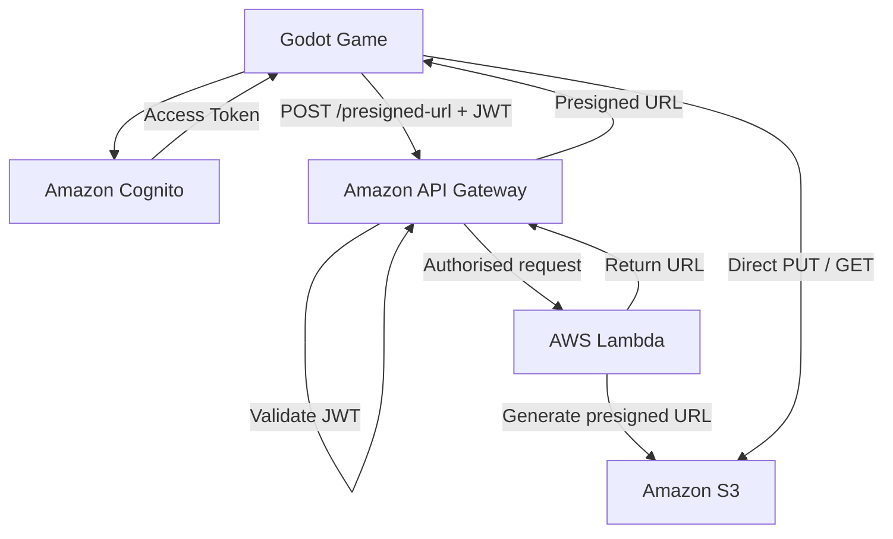

# Godot Cloud Save Lab

A hands-on cloud engineering project exploring how to integrate Godot games with AWS services to build secure, scalable and cost-conscious cloud save systems.

The project uses separate implementations to explore different backend architectures, from direct object storage with temporary access URLs to more advanced serverless approaches.

**Current focus:** Project 1 — Amazon Cognito, API Gateway, AWS Lambda and Amazon S3.

---

## Project Overview

The Godot application provides a lobby where users can access three independent cloud-save implementations.

Each project is intended to demonstrate a different approach to storing and retrieving player data using cloud services.

| Project | Description | Status |
|---|---|---|
| Project 1 | First cloud-save implementation, using Amazon S3 and presigned URLs with Cognito authentication | Completed |
| Project 2 | Second cloud-save implementation | Planned |
| Project 3 | Third cloud-save implementation | Planned |

Projects 2 and 3 are reserved for future development. Their architectures and implementation details will be documented when development begins.

## Project 1 — Amazon S3 + Presigned URLs

<details>
<summary><strong>Architecture and implementation</strong></summary>

Project 1 uses a serverless architecture to authenticate players and store their game data in a private Amazon S3 bucket.

The main AWS services are:

- **Amazon Cognito:** Manages player registration, email verification, sign-in and password reset.
- **Amazon API Gateway:** Provides an authenticated HTTP endpoint for requesting upload and download URLs.
- **AWS Lambda:** Processes authenticated requests, obtains the player's identity and generates presigned S3 URLs.
- **Amazon S3:** Stores player save files privately.

### Architecture



### Authentication

Players register and sign in through Amazon Cognito.

The application supports:

- User registration
- Email verification
- Sign-in using the supported username or email identifier
- Password reset through email verification
- Local logout

Cognito returns authentication tokens after successful sign-in. The Godot application uses the access token when requesting a presigned URL.

The application communicates directly with Cognito over HTTPS using its JSON API.

### Authorisation

API Gateway uses a JWT authoriser to validate the Cognito access token before forwarding a request to Lambda.

Lambda reads the verified Cognito claims from the API Gateway event. It checks that the token is an access token and obtains the player's unique Cognito `sub` identifier.

The player ID is not supplied by the game client. Lambda constructs the S3 object key using the authenticated identity:

```text
players/{cognito-sub}.json
```

This ensures that the URL-generation process is tied to the authenticated player.

### Upload and download

The Godot application sends an authenticated POST request to API Gateway.

The request contains an action:

```json
{
  "action": "upload"
}
```

or:

```json
{
  "action": "download"
}
```

Lambda generates the appropriate presigned URL:

- `PUT` for uploading a save file.
- `GET` for downloading a save file.

The URLs expire after 300 seconds (five minutes).

The actual JSON save file is transferred directly between Godot and S3. It does not pass through API Gateway or Lambda.

### Amazon S3 configuration

The project uses a private S3 bucket with the following settings:

- Block Public Access enabled.
- ACLs disabled.
- Default server-side encryption using SSE-S3.
- Versioning disabled.
- Player objects stored under the `players/` prefix.

The Lambda execution role has restricted permissions to generate URLs for objects under this prefix, using `s3:PutObject` and `s3:GetObject`.

</details>

## Godot Application

The project uses Godot 4 and GDScript.

The main scene acts as a lobby, allowing players to navigate to the individual project implementations.

Current structure:
```
godot-cloud-save-lab/
├── README.md
├── Main.tscn
├── main.gd
│
├── project-1/
│   ├── CognitoS3Presigned.tscn
│   ├── cognito_s3_presigned.gd
│   ├── cognito_auth.gd
│   ├── cloud_save_service.gd
│   ├── backed-tests/
│   └── docs/
│       ├── architecture.md
│       ├── aws-setup.md
│       ├── godot-implementation.md
│       ├── security.md
│       └── testing.md
│
├── project-2/
│   └── ...
│
└── project-3/
    └── ...
```
Project 1 separates its main responsibilities across three scripts:

| Script | Responsibility |
|---|---|
| `cognito_s3_presigned.gd` | Controls the user interface, authentication screens and cloud-save interactions. |
| `cognito_auth.gd` | Handles Cognito registration, verification, authentication and password reset. |
| `cloud_save_service.gd` | Communicates with API Gateway and performs direct S3 uploads and downloads. |

The application keeps authentication tokens in memory during the session. The save data is represented as JSON.

## Testing

Project 1 was tested progressively, starting with individual AWS services and then moving to the complete Godot application.

Python scripts were used on Ubuntu to test:

- Cognito registration and sign-in.
- Lambda presigned URL generation.
- API Gateway integration.
- Direct S3 uploads and downloads.
- Authenticated upload and download workflows.

The Godot application was also tested for:

- Account registration and email verification.
- Sign-in and invalid credentials.
- Password reset.
- Cloud saving and loading.
- Restoring saved data after restarting the application.
- Separation of data between two player accounts.
- Handling players without an existing save file.

The project was also checked using Godot 4.7.2 in headless mode and `git diff --check`.

More details are available in the testing documentation.

## Documentation

The `project-1/docs/` directory contains detailed documentation for the project.

| Document | Description |
|---|---|
| [Architecture](docs/architecture.md) | Overall system architecture and component relationships. |
| [AWS Setup](docs/aws-setup.md) | AWS services, resource configuration and setup instructions. |
| [Godot Implementation](docs/godot-implementation.md) | Godot scenes, scripts and application workflows. |
| [Security](docs/security.md) | Authentication, JWT validation, IAM permissions and data protection. |
| [Testing](docs/testing.md) | Backend and Godot application testing procedures and results. |

## Technologies

- **Game Engine:** Godot 4
- **Programming Languages:** GDScript, Python
- **Cloud Platform:** Amazon Web Services (AWS)
- **Authentication:** Amazon Cognito
- **API:** Amazon API Gateway HTTP API
- **Compute:** AWS Lambda
- **Storage:** Amazon S3
- **Backend SDK:** Boto3
- **Development Environment:** Ubuntu Linux

## Learning Objectives

This project is intended to develop practical experience with:

- Integrating a game engine with cloud services.
- Designing serverless backend architectures.
- Implementing user authentication with Amazon Cognito.
- Understanding JWT-based authorisation.
- Configuring IAM roles and least-privilege permissions.
- Working with private S3 buckets and presigned URLs.
- Transferring data securely between a game client and AWS.
- Testing cloud services independently before integrating them into an application.
- Comparing different cloud storage architectures.

## Current Limitations

Project 1 is a learning implementation rather than a production-ready game backend.

Some features have not yet been implemented, including:

- Automatic authentication token refresh.
- Remote sign-out and refresh-token revocation.
- Multi-factor authentication.
- Advanced Cognito authentication challenges.
- Dedicated request rate limiting.
- Cryptographic verification of save-file integrity.

These limitations and the current security design are explained in [Security](docs/security.md).

## Future Development

Projects 2 and 3 will be developed separately from Project 1.

Their final architectures, AWS services, implementation details and testing procedures will be added here as the project evolves.

The overall goal is to build and compare multiple approaches to cloud saving in Godot, while gaining practical experience with AWS architecture, security, serverless development and cloud integration.

---

**Note:** This is an independent learning and portfolio project. AWS resources are used for development and testing, and availability may change as the project evolves.