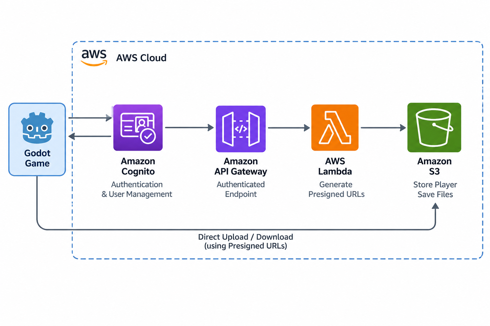
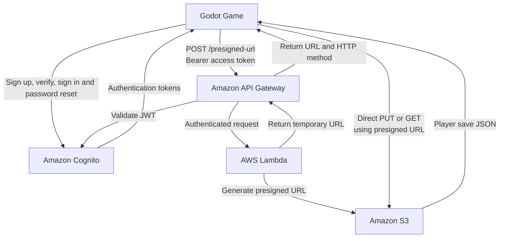

# Architecture — Godot AWS Cloud Save

## 1. Project Overview

Godot Cloud Save Lab is a learning project designed to explore different ways of implementing cloud-based game saving systems using Amazon Web Services (AWS).

The project compares three different architectures:

1. **Project 1 — Amazon S3 + Presigned URLs:** Uses Amazon S3 to store player save files. AWS Lambda generates temporary presigned URLs, allowing Godot to communicate directly with S3.
2. **Project 2 — API Gateway + Lambda + S3:** Uses API Gateway and Lambda to handle communication between Godot and S3, with the intention of passing save data through the backend.
3. **Project 3 — API Gateway + Lambda + DynamoDB:** Uses Amazon DynamoDB instead of S3 to store player data.

Each project is designed as an independent implementation so that the different approaches can be explored and compared without relying on shared authentication or cloud services.

This document focuses on Project 1, which implements the S3 and presigned URL architecture.

## 2. Project 1 — Architecture Overview

Project 1 uses Amazon Cognito for user authentication, Amazon API Gateway to provide a secure API endpoint, AWS Lambda to generate presigned URLs, and Amazon S3 to store player save files.

The main idea is to avoid sending the actual save data through Lambda. Instead, Lambda generates a temporary URL that gives an authenticated player permission to upload or download their own save file directly from S3.

The architecture uses the following AWS services:

| AWS Service | Purpose |
|---|---|
| Amazon Cognito | Handles player registration, email verification, sign-in and password resets. |
| Amazon API Gateway | Provides an HTTP API endpoint and validates Cognito access tokens using a JWT authoriser. |
| AWS Lambda | Verifies the authenticated request context and generates presigned S3 URLs. |
| Amazon S3 | Stores player save files as JSON objects. |
| AWS IAM | Controls which AWS resources and actions the Lambda function can access. |

The entire implementation uses the `eu-north-1` AWS Region (Europe — Stockholm).

## 3. High-Level Architecture

The following diagram illustrates how the main components communicate.




The architecture separates authentication, URL generation and file storage. Each service has a specific responsibility, which makes the system easier to understand and manage.

## 4. Authentication Flow

Amazon Cognito is responsible for managing player accounts and authentication.

When a player creates an account, Godot communicates directly with the Cognito User Pool. The player can register using a username, email address and password. Cognito sends an email verification code, which the player must confirm before signing in.

The application also supports password resets through Cognito's password recovery operations.

After successful sign-in, Cognito returns authentication tokens. Godot keeps the required tokens in memory and uses the access token when communicating with API Gateway.

The access token is sent in the HTTP `Authorization` header using the Bearer authentication scheme.

API Gateway has a JWT authoriser configured to validate the token. It checks the token against the configured Cognito User Pool issuer and app client audience before allowing the request to reach Lambda.

This means that unauthenticated or invalid requests cannot use the API to request presigned URLs.

## 5. Save Upload Flow

When a player saves their game, the following process takes place:

1. Godot prepares the player's save data in JSON format.
2. Godot sends a `POST` request to the API Gateway endpoint.
3. The request includes the Cognito access token in the `Authorization` header.
4. API Gateway validates the token using its JWT authoriser.
5. If the request is authorised, API Gateway invokes the Lambda function.
6. Lambda extracts the player's unique Cognito `sub` value from the verified JWT claims.
7. Lambda checks that the token is an access token and constructs the player's S3 object key.
8. Lambda generates a presigned S3 upload URL using the `PutObject` operation.
9. Lambda returns the temporary URL and the required HTTP method to API Gateway.
10. API Gateway returns the response to Godot.
11. Godot sends the actual JSON save data directly to S3 using an HTTP `PUT` request.

The save file is stored using the following object key format:

```text
players/{player_id}.json
```

Here, `player_id` is the authenticated player's Cognito `sub` value.

For example:

```text
players/xxxxxxxx-xxxx-xxxx-xxxx-xxxxxxxxxxxx.json
```

Each player therefore has a separate save object.

**Important:** The actual save data does not pass through API Gateway or Lambda. These services only handle the request for a temporary upload URL.

## 6. Save Download Flow

Loading a saved game follows a similar process:

1. Godot sends a `POST` request to API Gateway with the action set to `download`.
2. The request includes the player's Cognito access token.
3. API Gateway validates the token and invokes Lambda.
4. Lambda extracts the authenticated player's Cognito `sub` value.
5. Lambda constructs the corresponding S3 object key.
6. Lambda generates a presigned S3 download URL using the `GetObject` operation.
7. The temporary URL is returned to Godot through API Gateway.
8. Godot sends an HTTP `GET` request directly to S3 using that URL.
9. S3 returns the player's JSON save data.
10. Godot processes the downloaded JSON and restores the player's game data.

The download process uses the same player-specific object key as the upload process. This ensures that the application requests the save file belonging to the authenticated player.

## 7. Presigned URLs

A presigned URL is a temporary URL generated by AWS that grants permission to perform a specific operation on an S3 object.

In this project, Lambda generates two types of presigned URLs:

| Operation | S3 action | HTTP method |
|---|---|---|
| Upload save | `PutObject` | PUT |
| Download save | `GetObject` | GET |

Each URL has an expiry time of **300 seconds (5 minutes)**.

The URLs are generated using the permissions of the Lambda execution role. This means Godot does not need direct AWS credentials or its own IAM permissions to access the S3 bucket.

The upload URL also specifies `application/json` as its content type. Godot must use the same content type when uploading the save file because it is included in the signed request.

Once a URL expires, it can no longer be used. Godot must request another URL from the API.

## 8. Player Identity and Save File Ownership

A key part of this architecture is how the application identifies each player.

Amazon Cognito assigns every user a unique identifier called `sub` (subject). This identifier is included in the Cognito JWT claims.

API Gateway validates the token before forwarding the request to Lambda. Lambda then extracts the verified `sub` claim from the API Gateway authoriser context.

The player ID is therefore not taken from the request body or trusted from a value supplied by Godot.

Instead, Lambda constructs the S3 object key using the authenticated identity:

```python
player_id = claims.get("sub")
object_key = f"players/{player_id}.json"
```

This approach helps prevent a player from requesting another player's save file simply by changing a player ID in the application.

## 9. Data Storage

Amazon S3 is used to store player save files.

Each save is stored as a JSON object inside the `players/` prefix of the bucket.

Example:

```text
godot-cloud-1/
└── players/
    ├── player-sub-001.json
    ├── player-sub-002.json
    └── player-sub-003.json
```

The names above are illustrative. In the actual implementation, the filenames are generated using each player's Cognito `sub` value.

S3 is an object storage service rather than a traditional file system. The `players/` prefix is used to organise objects and is displayed as a folder in the AWS Console.

The bucket is private, with S3 Block Public Access enabled. Player data is accessed through temporary presigned URLs rather than public object URLs.

## 10. API Communication

The project uses an Amazon API Gateway HTTP API with the following route:

| Setting | Value |
|---|---|
| API name | `GodotAPI` |
| Route method | POST |
| Route path | `/presigned-url` |
| Integration | AWS Lambda |
| Payload format version | 2.0 |
| Stage | `$default` |
| Authorisation | Cognito JWT authoriser |

Godot sends a JSON request body containing the requested action.

Example upload request:

```json
{
  "action": "upload"
}
```

Example download request:

```json
{
  "action": "download"
}
```

Lambda returns a JSON response containing the presigned URL, the required HTTP method, the S3 object key and the URL expiry time.

Example response:

```json
{
  "url": "PRESIGNED_S3_URL",
  "method": "PUT",
  "object_key": "players/PLAYER_ID.json",
  "expires_in": 300
}
```

The URL shown above is a placeholder. A real presigned URL contains temporary authentication information and should never be published in project documentation.

## 11. AWS Resource Configuration

The following resources are used in the current Project 1 configuration:

| Resource | Configuration |
|---|---|
| AWS Region | `eu-north-1` |
| S3 bucket | `godot-cloud-1` |
| S3 object prefix | `players/` |
| IAM policy | `GodotProject1PlayerDataAccess` |
| IAM role | `GodotProject1LambdaRole` |
| Lambda function | `GodotProject1Lambda` |
| Lambda runtime | Python 3.14 |
| Lambda memory | 128 MB |
| Lambda timeout | 10 seconds |
| Cognito User Pool | `eu-north-1_GzGUofS7H` |
| Cognito app client | `GodotProject1Client` |
| Cognito app client ID | `3ke1alihifaae1trmt2ek0pncp` |
| API Gateway | `GodotAPI` |
| API ID | `0mnj6h83vi` |
| API route | `POST /presigned-url` |
| Presigned URL expiry | 300 seconds |

These identifiers describe the AWS configuration used for this implementation. They may need to be updated if the resources are recreated in another AWS account or Region.

## 12. Why This Architecture?

The main reason for choosing S3 and presigned URLs is to keep the architecture relatively simple and cost-effective.

Lambda does not need to receive, process or forward the actual player save files. It only generates temporary URLs. The game then communicates directly with S3.

This approach offers several advantages:

- **Reduced backend data transfer:** Save files do not need to pass through Lambda.
- **Temporary access:** Presigned URLs expire after five minutes.
- **Player separation:** Each player's save file uses their authenticated Cognito identity.
- **No AWS credentials in Godot:** The game does not need access keys or IAM credentials.
- **Private storage:** The S3 bucket does not need to be publicly accessible.
- **Simple scaling:** S3 handles the actual file storage and transfer.

The architecture also has limitations. The application relies on a network connection to upload and download cloud saves. The presigned URLs are temporary, and the current implementation stores each player's save as a single JSON object rather than maintaining a separate history of save versions.

## 13. Project Status

Project 1 has been implemented with Amazon Cognito authentication, password recovery, API Gateway, Lambda-generated presigned URLs and Amazon S3 storage.

Projects 2 and 3 are part of the wider Cloud Save Lab comparison. Their purpose is to explore alternative backend architectures, but they should be documented as separate implementations once their functionality has been completed.

---