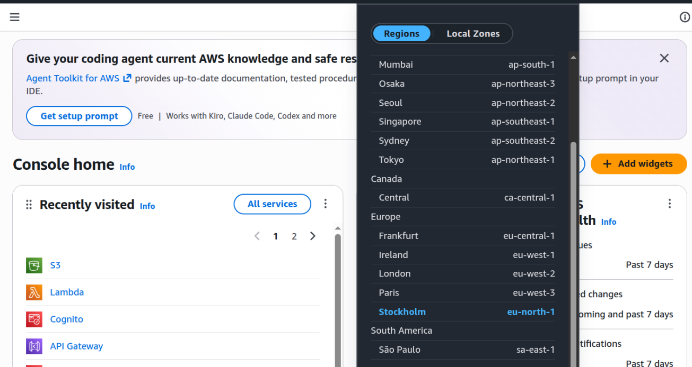
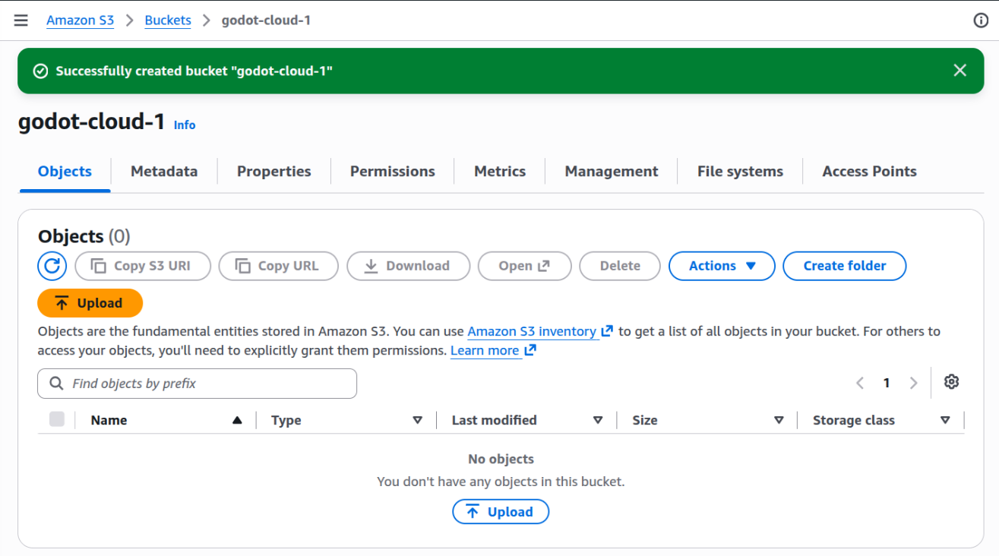
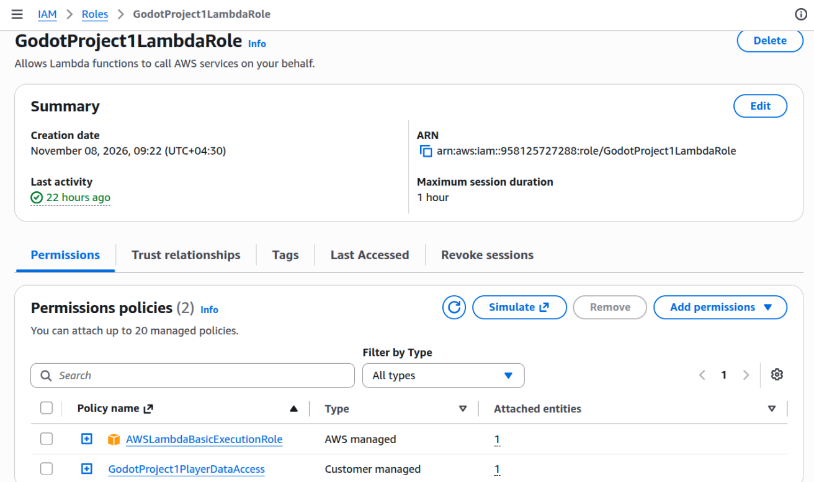
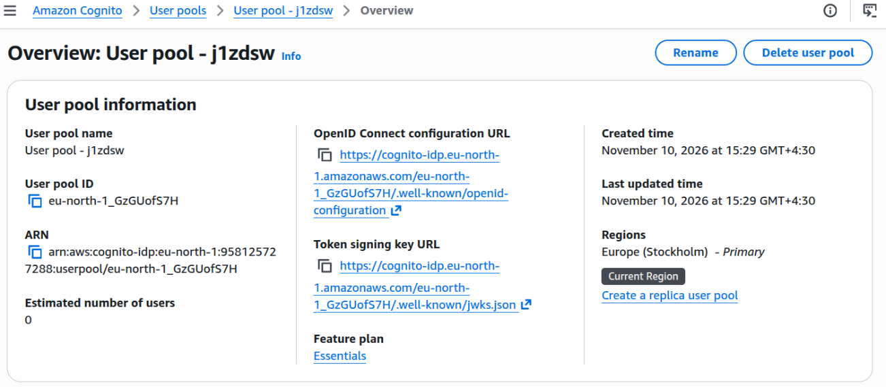
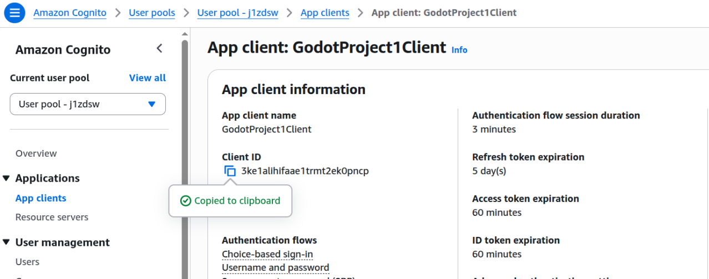
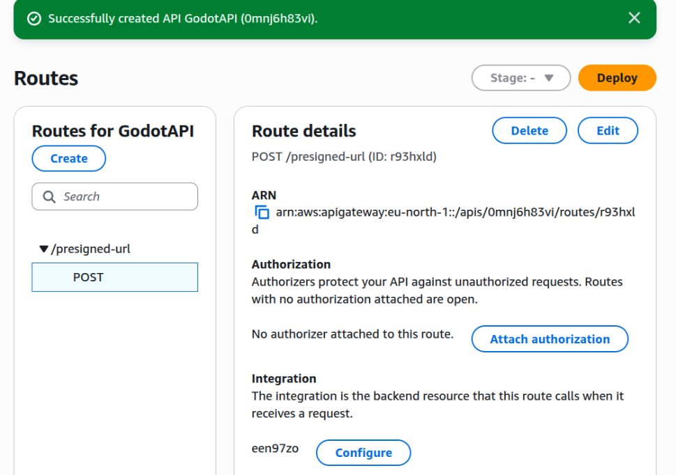

# AWS Setup — Godot Cloud Save Lab (Project 1)

## 1. Introduction

This guide explains how to configure the AWS infrastructure for Project 1 of Godot Cloud Save Lab.

The project uses Amazon Cognito for player authentication, Amazon API Gateway to provide a protected HTTP endpoint, AWS Lambda to generate presigned URLs, and Amazon S3 to store player save files.

The objective is to create a private, cost-conscious cloud save system in which players can upload and download their game data without exposing AWS credentials or making the S3 bucket publicly accessible.

Before starting, make sure you have access to an AWS account with sufficient permissions to create and configure the required services.

## 2. Choose an AWS Region

Before creating any resources, check which AWS Region you are using.

For this project, I use:

- **Region:** Europe (Stockholm)
- **Region code:** `eu-north-1`

I keep all the project's AWS resources in the same Region. This makes the configuration easier to manage and avoids unnecessary cross-Region communication.

Whenever creating or configuring a resource, check that the AWS Console is still set to `eu-north-1`.

## 3. Create an Amazon S3 Bucket

Amazon S3 (Simple Storage Service) is an object storage service. It allows applications to store and retrieve data without managing traditional storage servers.

In this project, S3 stores each player's game save as a JSON object.

### 3.1 Create the bucket

Open Amazon S3 and create a new general purpose bucket.

For the bucket name, use:

```text
godot-cloud-1
```

S3 bucket names must be globally unique across AWS. This means that another AWS customer cannot already have a bucket with the same name.

If the name is unavailable, choose another globally unique name and remember to update the Lambda environment variable and IAM policy accordingly.

Keep the bucket in the `eu-north-1` Region.

### 3.2 Configure bucket settings

Use the following security settings:

**Object Ownership**

Select ACLs disabled (recommended).

Access Control Lists (ACLs) are an older way of managing access to S3 objects. Disabling them simplifies access management because permissions are controlled through IAM and bucket policies instead.

**Block Public Access**

Keep all Block Public Access options enabled.

The bucket contains private player data, so there is no reason to make it publicly accessible. Players will access their objects through temporary presigned URLs instead.

**Bucket Versioning**

Leave bucket versioning disabled.

Versioning allows S3 to retain multiple versions of an object when it is overwritten or deleted. Although this can help recover previous data, it can also increase storage costs as more versions accumulate.

Since the goal of this learning project is to keep costs low and the application only needs the latest save, I leave versioning disabled.

**Default Encryption**

Keep the default encryption setting:

```text
Server-side encryption with Amazon S3 managed keys (SSE-S3)
```

SSE-S3 automatically encrypts objects at rest using keys managed by Amazon S3.

This provides encryption without requiring me to create or manage encryption keys through AWS Key Management Service (KMS).

After checking these settings, create the bucket.

### 3.3 Create the players prefix

Inside the newly created bucket, create a folder named:

```text
players
```

Do not add a `/` when entering the folder name in the S3 Console.

This prefix is where the application will store player save objects.

For example:

```text
players/player-sub-001.json
players/player-sub-002.json
```

An important detail is that S3 does not use traditional folders in the same way as a desktop file system. It stores objects with keys, and the `/` character is commonly used to organise those keys into prefixes.

The S3 Console displays these prefixes as folders to make navigation easier.

When creating the prefix, leave the encryption key setting at its default value. The bucket's default encryption will be applied to objects stored in it.


## 4. Configure AWS IAM

Before creating the Lambda function, I configure its IAM permissions.

AWS Identity and Access Management (IAM) controls who or what can access AWS resources and which actions they are allowed to perform.

Lambda needs permission to generate presigned URLs for objects in the S3 bucket. To achieve this, I create a custom IAM policy and attach it to a Lambda execution role.

### 4.1 Create an IAM policy

Open IAM and create a new policy using the JSON editor.

Use the following policy:

```json
{
  "Version": "2012-10-17",
  "Statement": [
    {
      "Effect": "Allow",
      "Action": [
        "s3:PutObject",
        "s3:GetObject"
      ],
      "Resource": "arn:aws:s3:::godot-cloud-1/players/*"
    }
  ]
}
```

Name the policy:

```text
GodotProject1PlayerDataAccess
```

### 4.2 Understand the policy

The policy contains several important elements:

- `Version`: Specifies the IAM policy language version.
- `Effect`: `Allow` means the specified actions are permitted.
- `Action`: Defines which S3 operations are allowed.
- `Resource`: Defines the exact S3 objects to which the permissions apply.

The two permitted actions are:

| Action | Purpose |
|---|---|
| `s3:PutObject` | Allows Lambda to generate upload presigned URLs for objects. |
| `s3:GetObject` | Allows Lambda to generate download presigned URLs for objects. |

The resource ARN is:

```text
arn:aws:s3:::godot-cloud-1/players/*
```

This restricts the policy to objects under the `players/` prefix in the `godot-cloud-1` bucket.

The `*` represents any object key beneath that prefix.

This is an example of the principle of least privilege: give a service only the permissions it needs, rather than granting access to an entire bucket or account.

### 4.3 Create the Lambda execution role

Now create an IAM role for the Lambda function.

Choose:

- **Trusted entity type:** AWS service
- **Use case:** Lambda

A trusted entity defines which service is allowed to assume the role. Since this role is intended for a Lambda function, AWS Lambda must be the trusted service.

Attach these two policies:

1. `GodotProject1PlayerDataAccess`
2. `AWSLambdaBasicExecutionRole`

The first is the custom policy created earlier. It allows the function to work with player objects in S3.

The second is an AWS-managed policy that provides the basic permissions needed for Lambda to write execution logs to Amazon CloudWatch Logs.

These logs are useful when troubleshooting the function.

Name the role:

```text
GodotProject1LambdaRole
```

Once created, this role can be selected as the Lambda function's execution role.


## 5. Create the AWS Lambda Function

AWS Lambda is a serverless compute service. It allows code to run in response to events without requiring me to manage or maintain a server.

In this project, Lambda receives authenticated requests from API Gateway and generates temporary S3 presigned URLs.

It does not receive or process the actual game save file.

### 5.1 Create the function

Open AWS Lambda and create a new function.

Use the following configuration:

| Setting | Value |
|---|---|
| Function name | `GodotProject1Lambda` |
| Runtime | Python 3.14 |
| Execution role | Use an existing role |
| Existing role | `GodotProject1LambdaRole` |

A runtime provides the language environment in which Lambda executes the function. Python 3.14 allows the function to run the Python code used in this project.

Under execution permissions, select the existing role created in the IAM section.

### 5.2 Configure the function

After creating the function, open its configuration and review the general settings.

Use:

| Setting | Value |
|---|---|
| Memory | 128 MB |
| Ephemeral storage | 512 MB |
| Timeout | 10 seconds |
| SnapStart | None |

The memory allocation determines how much memory is available to the function. It also affects the CPU resources allocated by Lambda.

I use the minimum 128 MB allocation because the function performs relatively lightweight operations: it validates a request, reads authentication claims and generates a presigned URL.

The ephemeral storage provides temporary local storage while the function executes. The default 512 MB is sufficient because this implementation does not need to store large files locally.

The default Lambda timeout is 3 seconds. I increase it to 10 seconds to provide additional time for the function to initialise and communicate with AWS services. This does not mean every request takes 10 seconds; it is simply the maximum execution time before Lambda terminates the invocation.

SnapStart is not required for this implementation, so I leave it disabled.

### 5.3 Add an environment variable

Open the function's environment variables configuration and add:

| Key | Value |
|---|---|
| `BUCKET_NAME` | `godot-cloud-1` |

An environment variable allows configuration values to be supplied to the function without hardcoding them into the source code.

The function reads the bucket name using:

```python
BUCKET_NAME = os.environ["BUCKET_NAME"]
```

This makes it easier to change the target bucket later without rewriting the function's main logic.

### 5.4 Add the Lambda code

Open the Lambda code editor and replace the default code with the following implementation:

```python
import json
import os
import re
import boto3

from botocore.config import Config


# Initialise the S3 client
s3 = boto3.client(
    "s3",
    region_name="eu-north-1",
    config=Config(
        signature_version="s3v4",
        s3={
            "addressing_style": "virtual"
        }
    )
)

# Read the bucket name from Lambda environment variables
BUCKET_NAME = os.environ["BUCKET_NAME"]


def response(status_code, data):
    """Return a response in API Gateway HTTP API format."""
    return {
        "statusCode": status_code,
        "headers": {
            "Content-Type": "application/json"
        },
        "body": json.dumps(data)
    }


def lambda_handler(event, context):

    try:
        # Only accept API Gateway HTTP API v2 requests
        if event.get("version") != "2.0":
            return response(401, {
                "error": "Authenticated API Gateway request required"
            })

        # Check the HTTP method
        method = event.get(
            "requestContext", {}
        ).get("http", {}).get("method")

        if method != "POST":
            return response(405, {
                "error": "Method not allowed"
            })

        # Extract verified Cognito JWT claims
        claims = event.get(
            "requestContext", {}
        ).get(
            "authorizer", {}
        ).get(
            "jwt", {}
        ).get("claims", {})

        # Obtain the player's unique Cognito ID
        player_id = claims.get("sub")

        # Ensure the request uses a Cognito access token
        if claims.get("token_use") != "access":
            return response(401, {
                "error": "Access token required"
            })

        if not isinstance(player_id, str) or not re.fullmatch(
            r"[A-Za-z0-9-]{1,64}", player_id
        ):
            return response(401, {
                "error": "Invalid player identity"
            })

        # Read the request body
        body = event.get("body")

        if not body:
            return response(400, {
                "error": "Request body is missing"
            })

        request_data = json.loads(body)

        if not isinstance(request_data, dict):
            return response(400, {
                "error": "Invalid request format"
            })

        # Extract the requested action
        action = request_data.get("action")

        if action not in ["upload", "download"]:
            return response(400, {
                "error": "Invalid action"
            })

        # Construct the S3 key using the authenticated player ID
        object_key = f"players/{player_id}.json"

        if action == "upload":

            # Generate a temporary upload URL
            url = s3.generate_presigned_url(
                ClientMethod="put_object",
                Params={
                    "Bucket": BUCKET_NAME,
                    "Key": object_key,
                    "ContentType": "application/json"
                },
                ExpiresIn=300
            )

            method = "PUT"

        else:

            # Generate a temporary download URL
            url = s3.generate_presigned_url(
                ClientMethod="get_object",
                Params={
                    "Bucket": BUCKET_NAME,
                    "Key": object_key
                },
                ExpiresIn=300
            )

            method = "GET"

        # Return the generated URL
        return response(200, {
            "url": url,
            "method": method,
            "object_key": object_key,
            "expires_in": 300
        })

    except json.JSONDecodeError:
        return response(400, {
            "error": "Invalid JSON request body"
        })

    except Exception:
        print("Failed to process request or generate presigned URL.")

        return response(500, {
            "error": "Could not process request"
        })
```

Save and deploy the function.

### 5.5 Important parts of the Lambda code

**Initialising the S3 client**

```python
s3 = boto3.client(
    "s3",
    region_name="eu-north-1",
    config=Config(
        signature_version="s3v4",
        s3={
            "addressing_style": "virtual"
        }
    )
)
```

Boto3 is the AWS SDK for Python. It allows Python applications to interact with AWS services.

Here, I initialise an S3 client so that Lambda can generate presigned URLs.

The configuration explicitly uses Signature Version 4, AWS's signing mechanism for authenticated requests. Virtual-hosted-style addressing places the bucket name in the hostname of the S3 request.

**Reading the bucket name**

```python
BUCKET_NAME = os.environ["BUCKET_NAME"]
```

This reads the bucket name from the Lambda environment variable rather than hardcoding it into the function.

**Checking the API Gateway request**

```python
if event.get("version") != "2.0":
```

The function expects the event format used by API Gateway HTTP API payload version 2.0.

It also checks that the request uses the `POST` method.

**Extracting the authenticated player**

```python
claims = event.get(
    "requestContext", {}
).get(
    "authorizer", {}
).get(
    "jwt", {}
).get("claims", {})
```

API Gateway provides the verified JWT claims in the Lambda event after the JWT authoriser successfully validates the token.

The function then extracts the Cognito subject:

```python
player_id = claims.get("sub")
```

It checks that the token is an access token and validates the format of the player ID.

This is important because the application must not rely on a player ID supplied by the client. The identity comes from the token that API Gateway has validated.

**Determining the requested operation**

```python
action = request_data.get("action")
```

The request body tells Lambda whether Godot needs an upload or download URL.

Only these two actions are accepted:

- `upload`
- `download`

**Constructing the object key**

```python
object_key = f"players/{player_id}.json"
```

The object key is generated from the authenticated player's Cognito ID.

This ensures that each authenticated account uses its own save file.

**Generating a presigned upload URL**

```python
url = s3.generate_presigned_url(
    ClientMethod="put_object",
    Params={
        "Bucket": BUCKET_NAME,
        "Key": object_key,
        "ContentType": "application/json"
    },
    ExpiresIn=300
)
```

This generates a temporary URL for the S3 `PutObject` operation.

The `ContentType` is included in the signed request, so Godot must send the upload using the same content type: `application/json`.

**Generating a presigned download URL**

```python
url = s3.generate_presigned_url(
    ClientMethod="get_object",
    Params={
        "Bucket": BUCKET_NAME,
        "Key": object_key
    },
    ExpiresIn=300
)
```

This generates a temporary URL for the S3 `GetObject` operation.

**URL expiration**

Both operations use:

```python
ExpiresIn=300
```

The generated URL is valid for up to 300 seconds (5 minutes), subject to the validity of the underlying credentials and permissions.

**Returning the response**

The function returns a JSON response containing the URL, HTTP method, object key and expiration time.

Godot uses this information to make the actual request directly to S3.

**Error handling**

The function handles invalid JSON separately and returns appropriate HTTP status codes for different request problems.

Unexpected errors return a generic server error. The code deliberately avoids printing the request body, authentication token or presigned URL to the logs.

## 6. Create an Amazon Cognito User Pool

Amazon Cognito is an authentication service that allows applications to manage user accounts, registration and sign-in without building their own authentication infrastructure.

In this project, Cognito manages player accounts and provides the tokens used to protect the API Gateway endpoint.

### 6.1 Create a User Pool

Open Amazon Cognito and create a new User Pool.

A User Pool is a directory of users. It stores account information and manages operations such as registration, email verification, authentication and password recovery.

For the application type, select:

```text
Mobile app
```

This is appropriate for a native application such as a Godot game. The application type helps guide the initial configuration, although it does not prevent the client from being used on another supported platform.

For the app name, enter:

```text
GodotProject1Client
```

### 6.2 Configure sign-in identifiers

Select:

- Email
- Username

Do not select phone number for this project.

This allows players to use either their email address or username as their sign-in identifier.

### 6.3 Configure required sign-up attributes

Select:

```text
email
```

This makes an email address a required attribute during registration.

The email address is also used for account verification and password recovery.

**Important:** Cognito User Pool sign-in options and required attributes are fundamental User Pool configuration choices. They cannot simply be changed later in the same way as an ordinary app client setting. Check them carefully before creating the User Pool.

Create the User Pool.

### 6.4 Record the User Pool information

After creation, open the User Pool overview and locate the User Pool ID.

The current configuration uses:

```text
eu-north-1_GzGUofS7H
```

The User Pool ID is used to construct the issuer URL required by API Gateway.

The issuer URL is:

```text
https://cognito-idp.eu-north-1.amazonaws.com/eu-north-1_GzGUofS7H
```

Cognito also provides two useful OpenID Connect endpoints:

**OIDC discovery document**

```text
https://cognito-idp.eu-north-1.amazonaws.com/eu-north-1_GzGUofS7H/.well-known/openid-configuration
```

**JSON Web Key Set (JWKS)**

```text
https://cognito-idp.eu-north-1.amazonaws.com/eu-north-1_GzGUofS7H/.well-known/jwks.json
```

The discovery document provides information about the User Pool's OpenID Connect configuration. The JWKS endpoint provides the public signing keys used to verify JWT signatures.

API Gateway uses the configured issuer to discover the relevant signing keys and validate tokens. These URLs are useful for understanding and troubleshooting the authentication setup, but the application does not need to hardcode all of them.

**Configuration information and privacy**

Resource identifiers such as User Pool IDs, app client IDs and API endpoints are not equivalent to passwords or secret access keys. However, it is still sensible to avoid publishing unnecessary account information, personal email addresses, authentication tokens or secret credentials.

If the User Pool is deleted after the project, its identifiers will no longer refer to an active resource. Keep a record of the configuration if you intend to recreate the project later.


### 6.5 Configure the app client

An app client represents an application that is allowed to interact with a Cognito User Pool.

Open the User Pool's App clients section and select:

```text
GodotProject1Client
```

Locate the authentication flow configuration and enable:

```text
ALLOW_USER_PASSWORD_AUTH
```

This allows the application to authenticate using a username and password through Cognito's `USER_PASSWORD_AUTH` flow.

This project uses that flow through Cognito's `InitiateAuth` operation. It does not use the Secure Remote Password (SRP) authentication flow.

Keep in mind that password authentication means the application sends the username and password to Cognito over HTTPS. The application must never log or store the password.

Also ensure that self-registration is enabled in the User Pool configuration.

Self-registration allows new players to create their own accounts through the game's registration screen. Without it, players cannot use the application's public sign-up flow.

The project also uses Cognito email verification. Password recovery requires an appropriate verified email address and working Cognito email delivery configuration.

### 6.6 Record the app client ID

Open the app client information panel and copy the app client ID.

The current value is:

```text
3ke1alihifaae1trmt2ek0pncp
```

This is a public app client identifier, not an AWS secret access key.

Godot uses it when sending authentication requests directly to Cognito. API Gateway also uses it as the expected audience when validating Cognito access tokens.

The app client must be configured as a public client without a client secret because a native application cannot securely keep a client secret.


## 7. Create an Amazon API Gateway HTTP API

Amazon API Gateway is a managed service that allows applications to expose APIs without managing their own API servers.

In this project, API Gateway provides a single endpoint through which Godot requests temporary S3 URLs.

It also validates Cognito access tokens before allowing requests to reach Lambda.

### 7.1 Create the HTTP API

Open API Gateway and create a new API.

Select:

```text
HTTP API
```

An HTTP API is suitable for this project because it provides the HTTP routing and JWT authorisation functionality required by the application, with a relatively simple configuration.

Name the API:

```text
GodotAPI
```

### 7.2 Configure the Lambda integration

Create an integration with:

- **Integration type:** Lambda
- **Lambda function:** `GodotProject1Lambda`
- **Payload format version:** `2.0`

The integration connects API Gateway to the Lambda function.

When API Gateway receives an authorised request, it invokes Lambda and passes the request information using the HTTP API payload format.

Payload version 2.0 is important because the Lambda code expects the corresponding event structure, including:

```python
event.get("version") == "2.0"
```

Keep the integration in the same AWS Region as the other project resources.

### 7.3 Configure the route

Create the following route:

| Setting | Value |
|---|---|
| Method | POST |
| Resource path | `/presigned-url` |
| Integration target | `GodotProject1Lambda` |

A route defines which HTTP requests API Gateway accepts and which integration handles them.

The application uses one route for both upload and download requests. The requested operation is specified in the JSON request body using the `action` field.

### 7.4 Configure the stage

Use the stage:

```text
$default
```

A stage is a named deployment of an API configuration.

The `$default` stage is useful here because it allows the API to use its default stage without requiring an additional stage name in the URL.

Enable automatic deployment so that changes to the API configuration are deployed automatically.


## 8. Configure the JWT Authoriser

A JWT authoriser allows API Gateway to validate JSON Web Tokens before forwarding requests to the integration.

This project uses Cognito access tokens to ensure that only authenticated players can request presigned URLs.

Open the API's authorisation configuration and create a JWT authoriser.

Use the name:

```text
GodotProjectCognitoAuthorizer
```

### 8.1 Configure the identity source

Set:

```text
$request.header.Authorization
```

The identity source tells API Gateway where to find the token in an incoming request.

Godot sends the Cognito access token using the HTTP Authorization header:

```text
Authorization: Bearer ACCESS_TOKEN
```

API Gateway extracts the token from this header and validates it.

### 8.2 Configure the issuer URL

Use the Cognito issuer URL:

```text
https://cognito-idp.eu-north-1.amazonaws.com/eu-north-1_GzGUofS7H
```

The issuer identifies the Cognito User Pool that issued the token.

API Gateway uses this value to establish which identity provider it should trust when validating JWTs.

### 8.3 Configure the audience

Enter the Cognito app client ID:

```text
3ke1alihifaae1trmt2ek0pncp
```

The audience identifies the intended recipient of the token.

In this configuration, API Gateway checks that the token is intended for the correct Cognito app client.

You can find this value in:

```text
Amazon Cognito
└── User pools
    └── Your User Pool
        └── App clients
            └── GodotProject1Client
```

Save the authoriser configuration.

### 8.4 Attach the authoriser to the route

Creating the authoriser alone is not enough. It must also be attached to the API route.

Open the API's Routes section, select:

```text
POST /presigned-url
```

Set its authorisation type to JWT and select:

```text
GodotProjectCognitoAuthorizer
```

Save the change and make sure the configuration is deployed.

After this, requests to the route must include a valid Cognito JWT before API Gateway invokes Lambda.

## 9. Record the API Endpoint

Open the API Gateway overview and locate the API's ID.

The current API ID is:

```text
0mnj6h83vi
```

The API's base invoke URL follows this format:

```text
https://API_ID.execute-api.REGION.amazonaws.com
```

For this project, the complete endpoint, including the route path, is:

```text
https://0mnj6h83vi.execute-api.eu-north-1.amazonaws.com/presigned-url
```

This is the endpoint Godot will use when requesting upload or download presigned URLs.

Keep the endpoint available because it must be added to the Godot cloud save service configuration.

## 10. Final AWS Configuration Reference

The following table summarises the resources created for Project 1.

| Resource | Name or configuration |
|---|---|
| AWS Region | `eu-north-1` |
| S3 bucket | `godot-cloud-1` |
| S3 prefix | `players/` |
| S3 ACLs | Disabled |
| S3 Block Public Access | Enabled |
| S3 versioning | Disabled |
| S3 encryption | SSE-S3 |
| IAM policy | `GodotProject1PlayerDataAccess` |
| IAM role | `GodotProject1LambdaRole` |
| Lambda function | `GodotProject1Lambda` |
| Lambda runtime | Python 3.14 |
| Lambda memory | 128 MB |
| Lambda timeout | 10 seconds |
| Lambda ephemeral storage | 512 MB |
| Lambda environment variable | `BUCKET_NAME=godot-cloud-1` |
| Cognito User Pool ID | `eu-north-1_GzGUofS7H` |
| Cognito app client | `GodotProject1Client` |
| Cognito app client ID | `3ke1alihifaae1trmt2ek0pncp` |
| API Gateway | `GodotAPI` |
| API ID | `0mnj6h83vi` |
| API route | `POST /presigned-url` |
| API stage | `$default` |
| JWT authoriser | `GodotProjectCognitoAuthorizer` |
| JWT issuer | `https://cognito-idp.eu-north-1.amazonaws.com/eu-north-1_GzGUofS7H` |
| JWT audience | `3ke1alihifaae1trmt2ek0pncp` |
| Presigned URL expiry | 300 seconds |

## 11. Before Moving to Godot

At this point, the AWS infrastructure is configured.

Before connecting Godot, check the following:

- The S3 bucket exists and is in `eu-north-1`.
- The `players/` prefix exists.
- The bucket remains private.
- The Lambda execution role has both required policies.
- The Lambda environment variable contains the correct bucket name.
- The Lambda function has been deployed successfully.
- The Cognito User Pool and app client are configured.
- Self-registration and the required authentication flow are enabled.
- The API Gateway Lambda integration uses payload version 2.0.
- The `POST /presigned-url` route is attached to the JWT authoriser.
- The API uses the `$default` stage with automatic deployment.
- The API endpoint is available.

The next step is to connect these AWS resources to the Godot application. This is covered in `godot-implementation.md`.

## 12. Cost Considerations

This architecture is designed to keep infrastructure simple and avoid unnecessary AWS usage.

However, AWS services can incur charges depending on usage, account eligibility and current pricing.

The main services to monitor are:

- **Amazon S3:** Storage, requests and data transfer.
- **AWS Lambda:** Function invocations and execution duration.
- **Amazon API Gateway:** API requests.
- **Amazon Cognito:** User-related usage and applicable feature-plan limits.
- **Amazon CloudWatch:** Log ingestion and storage.

The project uses a small Lambda memory allocation, a short timeout, no unnecessary S3 version history and direct S3 transfers using presigned URLs.

These choices help avoid unnecessary resource usage, but they do not guarantee that the project is completely free. Check AWS pricing and billing information for the account and Region being used.

