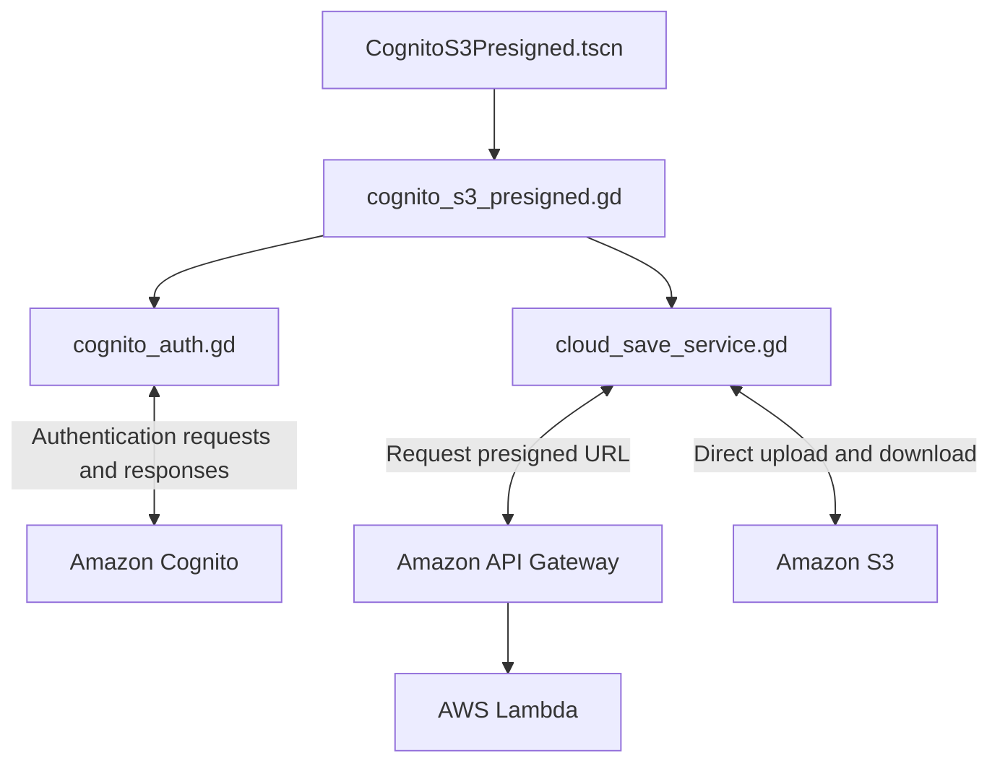
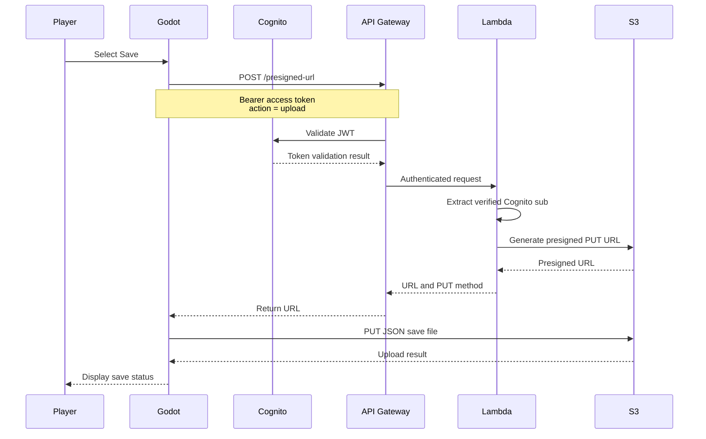

# Godot Implementation — Cloud Save Lab (Project 1)

## 1. Introduction

This document explains the Godot side of Project 1 of the Cloud Save Lab.

The objective is to connect a Godot game to the AWS infrastructure created for cloud-based player saving. The application allows players to register, verify their email addresses, sign in, recover forgotten passwords, save their game data to Amazon S3 and restore it later.

The Godot application does not communicate directly with S3 using AWS credentials. Instead, it authenticates players through Amazon Cognito and requests temporary S3 presigned URLs from the backend.

The implementation uses Godot 4 and GDScript.

## 2. Project Structure

The main project contains a lobby screen and three separate project scenes.

The lobby provides navigation to the three cloud save implementations:

- Project 1 — Amazon S3 + Presigned URLs
- Project 2 — API Gateway + Lambda + S3
- Project 3 — API Gateway + Lambda + DynamoDB

Each implementation has its own scene and scripts. This keeps the three approaches independent and makes it easier to compare their architectures.

The relevant structure for Project 1 is:

```text
aws-cloud-save/
│
├── Main.tscn
├── main.gd
│
├── project-1/
│   ├── CognitoS3Presigned.tscn
│   ├── cognito_s3_presigned.gd
│   ├── cognito_auth.gd
│   └── cloud_save_service.gd
│
├── project-2/
│   ├── ApiLambdaS3.tscn
│   └── api_lambda_s_3.gd
│
└── project-3/
    ├── ApiLambdaDynamoDB.tscn
    └── api_lambda_dynamo_db.gd
```

The structure above focuses on the main scenes and scripts. Other project resources, such as project settings, assets and editor files, are omitted for clarity.

## 3. Project 1 — Main Components

Project 1 uses three main GDScript files:

| File | Responsibility |
|---|---|
| `cognito_s3_presigned.gd` | Controls the user interface and coordinates authentication and cloud save operations. |
| `cognito_auth.gd` | Communicates directly with Amazon Cognito and manages authentication operations and tokens. |
| `cloud_save_service.gd` | Communicates with API Gateway to request presigned URLs and then transfers save data directly to S3. |

Each script has a separate responsibility. This keeps the authentication logic, cloud communication and user interface code organised.

The general relationship is:



## 4. The Authentication Script

File:

```text
project-1/cognito_auth.gd
```

This script handles communication between Godot and Amazon Cognito.

Instead of implementing a separate authentication backend, the application sends HTTPS requests directly to Cognito's authentication API.

### 4.1 Cognito configuration

The script contains the Cognito app client configuration.

The current app client ID is:

```gdscript
const CLIENT_ID := "3ke1alihifaae1trmt2ek0pncp"
```

The application also uses the Cognito endpoint in the `eu-north-1` Region.

The app client ID identifies the application to Cognito. It is not a password or secret access key.

If the Cognito User Pool or app client is recreated, the relevant configuration values in the application must be updated.

### 4.2 HTTP requests

The script uses Godot's `HTTPRequest` node to send requests to Cognito.

The requests use Cognito's JSON API and include the appropriate request headers, including:

```text
Content-Type: application/x-amz-json-1.1
X-Amz-Target: AWSCognitoIdentityProviderService.<operation>
```

The `X-Amz-Target` header identifies which Cognito operation the application wants to execute.

For example, registration and authentication use different Cognito operations.

### 4.3 Registration

When a player registers, the application sends a `SignUp` request to Cognito.

The request includes the app client ID, username, password and email address.

Cognito creates the account and sends an email verification code to the player.

The player must confirm the code before the account can be used for normal sign-in.

### 4.4 Email verification

The application uses Cognito's `ConfirmSignUp` operation to verify the registration code.

If the player does not receive the email, the application can request another code using `ResendConfirmationCode`.

This keeps account verification under Cognito's control rather than implementing a custom verification system.

### 4.5 Sign-in

The application uses Cognito's `InitiateAuth` operation with the `USER_PASSWORD_AUTH` authentication flow.

The username and password are sent directly to Cognito over HTTPS.

After successful authentication, Cognito returns tokens, including:

- **Access token:** Used to authenticate requests to the protected API Gateway endpoint.
- **ID token:** Contains identity-related claims about the authenticated user.
- **Refresh token:** Used by Cognito authentication flows to obtain new tokens when supported by the application.

The application keeps the relevant tokens in memory for subsequent operations.

The access token is particularly important because it is sent to API Gateway when requesting presigned URLs.

### 4.6 Forgot Password

The application also implements a password recovery process using Cognito.

This feature allows a player who has forgotten their password to reset it without creating a new account.

The process uses two Cognito operations.

**ForgotPassword**

Godot sends the player's username or email address to Cognito using the `ForgotPassword` operation.

Cognito sends a verification code to the player's verified email address.

**ConfirmForgotPassword**

The player enters the verification code, a new password and password confirmation.

Godot sends the username, confirmation code and new password to Cognito using `ConfirmForgotPassword`.

If Cognito accepts the request, the password is updated and the player can sign in using the new password.

The reset process communicates directly with Cognito. Passwords and verification codes do not pass through API Gateway, Lambda or S3.

The application also validates the input fields and checks that the new password and confirmation match before submitting the request.

### 4.7 Token management

The authentication script stores the authentication tokens in memory while the application is running.

It also tracks token expiry so that the application can determine whether a token is still valid before using it.

The tokens are not intended to be stored as part of the player's game save file.

A limitation of the current implementation is that automatic refresh-token handling is not implemented. If the access token expires, the player may need to sign in again.

The current logout implementation clears the locally held authentication tokens. It does not perform a remote Cognito sign-out or token revocation operation.

## 5. The Main Project 1 Controller

File:

```text
project-1/cognito_s3_presigned.gd
```

This script controls the Project 1 interface and coordinates the other two scripts.

It is responsible for displaying the appropriate screen, collecting player input, validating form fields, calling authentication operations and handling cloud save requests.

### 5.1 User interface navigation

The Project 1 scene contains separate interface sections for different stages of the application.

The main screens include:

- Login
- Registration
- Email verification
- Password recovery
- Player profile

The controller switches between these sections depending on the player's actions and the results returned by Cognito.

For example:

1. A new player opens the registration screen.
2. After registration, the application displays the email verification screen.
3. After successful verification, the player can return to login.
4. After successful login, the profile screen becomes available.
5. If the player selects Forgot Password, the password recovery screen is displayed instead.

This keeps the different account operations separate and gives the player a clear navigation flow.

### 5.2 Authentication signals

The controller connects to the signals exposed by `cognito_auth.gd`.

Signals allow one script to notify another script when an operation has completed.

For example, after a successful login, the authentication script emits a success signal. The controller receives it and updates the interface.

The same approach is used for registration, email verification, resending verification codes and password recovery.

This avoids placing all authentication and user interface logic in one large script.

### 5.3 Form validation

The controller validates user input before sending requests to Cognito.

Examples include:

- Checking that required fields are not empty.
- Checking that password confirmation matches the password.
- Ensuring that the required verification information has been entered.
- Displaying appropriate status messages when validation fails.

This provides immediate feedback to the player and avoids sending requests that can be rejected before reaching Cognito.

### 5.4 Player profile

After successful authentication, the controller displays the player's profile interface.

The player can interact with the cloud save functionality from this screen.

The controller coordinates the save and load operations by calling the cloud save service and responding to its results.

It also handles logout and returns the application to the appropriate authentication screen.

## 6. The Cloud Save Service

File:

```text
project-1/cloud_save_service.gd
```

This script handles communication with API Gateway and Amazon S3.

It does not implement authentication itself. Instead, it uses the access token obtained from the Cognito authentication script.

### 6.1 API endpoint configuration

The script contains the API Gateway endpoint:

```gdscript
const API_ENDPOINT := "https://0mnj6h83vi.execute-api.eu-north-1.amazonaws.com/presigned-url"
```

This is the endpoint used to request presigned URLs.

If API Gateway is recreated, this value must be updated to the new endpoint.

### 6.2 Requesting an upload URL

When the player saves the game, the service sends an HTTP `POST` request to API Gateway.

The request includes the Cognito access token in the Authorization header.

The JSON request body identifies the requested operation:

```json
{
  "action": "upload"
}
```

API Gateway validates the token using its JWT authoriser.

If the request is authorised, API Gateway invokes Lambda. Lambda obtains the player's identity from the verified Cognito claims and generates a presigned S3 upload URL.

The API response contains:

- The presigned URL
- The required HTTP method
- The S3 object key
- The URL expiry time

Godot receives this information and proceeds with the upload.

### 6.3 Uploading the save file

After receiving the presigned URL, Godot sends the actual save data directly to Amazon S3.

The service uses an HTTP `PUT` request with:

```text
Content-Type: application/json
```

The content type must match the one included when Lambda generated the presigned URL.

The JSON save data is uploaded to the player's own S3 object.

The important distinction is that the save file does not travel through API Gateway or Lambda. The API is only used to obtain permission to perform the upload.

### 6.4 Requesting a download URL

When the player wants to load their saved game, the service sends another authenticated `POST` request to API Gateway.

This time, the JSON body contains:

```json
{
  "action": "download"
}
```

Lambda generates a presigned URL for the S3 `GetObject` operation.

The API returns the temporary URL to Godot.

### 6.5 Downloading the save file

Godot sends an HTTP `GET` request directly to the presigned S3 URL.

S3 returns the JSON object, which the application can then process.

The cloud save service validates the downloaded JSON structure before passing the data back to the main controller.

This helps prevent invalid or unexpected data from being treated as a valid player save.

### 6.6 Player-specific storage

The application does not provide a player ID in the upload or download request body.

Instead, Lambda obtains the authenticated player's Cognito `sub` value and constructs the object key:

```text
players/{player_id}.json
```

This means that the same account always uses its own save object, regardless of the username displayed in the game.

## 7. Complete Save and Load Sequence

The following diagram summarises the upload process:



The download process follows the same initial authentication and URL-generation steps, but Lambda generates a `GET` URL and Godot retrieves the JSON object directly from S3.

## 8. Data Format

The application stores player save data as JSON.

JSON (JavaScript Object Notation) is a lightweight data format commonly used to exchange structured information between applications and services.

A simplified example of player save data might look like this:

```json
{
  "player_id": "PLAYER-001",
  "username": "Sammy",
  "level": 12,
  "coins": 850,
  "high_score": 4500,
  "games_played": 36
}
```

This example illustrates the type of information a game might store. The actual save structure is determined by the fields implemented in the Godot application.

The JSON file is uploaded to S3 as an object. When downloaded, Godot parses the JSON and restores the relevant player data.

The application uses the authenticated Cognito identity for the S3 object key. The `player_id` shown inside an illustrative JSON object should not be confused with the identity used by the backend to enforce player-specific storage.

## 9. Configuration Values

The Godot implementation requires two important AWS configuration values.

| File | Constant | Value |
|---|---|---|
| `cognito_auth.gd` | `CLIENT_ID` | `3ke1alihifaae1trmt2ek0pncp` |
| `cloud_save_service.gd` | `API_ENDPOINT` | `https://0mnj6h83vi.execute-api.eu-north-1.amazonaws.com/presigned-url` |

If the Cognito app client or API Gateway API is recreated, update the corresponding value in Godot.

The Cognito Region and endpoint must also remain consistent with the deployed User Pool.

These values identify public application resources. Do not put AWS access keys, secret keys, passwords or authentication tokens into the source code.

## 10. Security Considerations

The Godot application is a client application, so it must not contain AWS credentials or privileged IAM permissions.

The implementation follows several important security principles:

- Authentication is handled by Amazon Cognito.
- API Gateway validates the Cognito JWT before invoking Lambda.
- Godot sends an access token when requesting presigned URLs.
- Lambda derives player identity from the verified token claims.
- The player cannot choose another player's S3 object key through the API request body.
- S3 remains private, with Block Public Access enabled.
- Presigned URLs expire after five minutes.
- Passwords and password reset codes are sent directly to Cognito over HTTPS.
- Authentication tokens are kept in memory rather than included in player save files.

Presigned URLs are bearer credentials: anyone who obtains a valid URL may be able to use it for the operation it authorises until it expires or the underlying permissions become invalid. The application should therefore avoid displaying, logging or sharing these URLs.

For a fuller discussion of the security design, see `security.md`.

## 11. Current Implementation Scope and Limitations

Project 1 implements the main authentication and cloud save workflow.

The current implementation includes:

- Player registration
- Email verification
- Resending verification codes
- Username/password sign-in
- Forgot Password and password reset
- Authenticated requests to API Gateway
- Lambda-generated S3 presigned URLs
- Direct JSON uploads to S3
- Direct JSON downloads from S3
- Player-specific save object keys
- Save data validation

The current implementation also has some limitations:

- Automatic access-token refresh is not implemented.
- Logout clears local tokens but does not perform remote Cognito sign-out or token revocation.
- MFA handling is not implemented.
- Additional Cognito authentication challenges, such as new-password challenges, are not implemented.
- The application requires an internet connection for cloud authentication and cloud save operations.
- The current design stores one main save object per player rather than maintaining a save history.

These limitations are documented so that the current scope is clear and future improvements can be planned separately.

## 12. Conclusion

The Godot implementation connects the game interface to AWS without embedding privileged AWS credentials in the client.

Cognito manages player authentication, the main controller coordinates the interface and application logic, and the cloud save service handles communication with API Gateway and S3.

The use of presigned URLs allows the application to transfer save files directly between Godot and S3 while keeping the backend responsible for authentication checks and temporary access generation.

This completes the Godot implementation for Project 1 of the Cloud Save Lab.